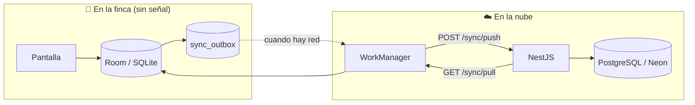
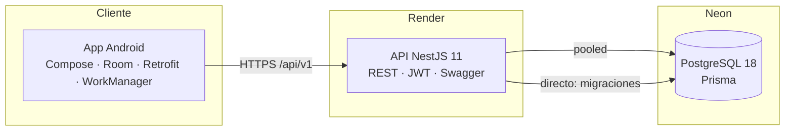

# 🐄 AgroControl

**Gestión ganadera que funciona con o sin internet.**

AgroControl es un sistema completo para administrar una finca: animales, potreros,
producción de leche o carne, eventos reproductivos y tareas de campo. Está formado
por una **app Android offline-first** para el trabajo diario en el potrero, una
**API REST** en la nube y una **base de datos PostgreSQL**. Lo que se registra sin
señal se guarda en el teléfono y se sincroniza automáticamente cuando vuelve la
conexión.

[](#stack-tecnológico)
[](#stack-tecnológico)
[](#stack-tecnológico)
[](#stack-tecnológico)
[](#demo-en-vivo)

> **Demo en vivo:** [Swagger de la API](https://agrocontrol-apjl.onrender.com/api/docs) ·
> usuario `demo@agrocontrol.local` / contraseña `demo1234`

---

## El problema que resuelve

En el campo la conectividad es intermitente: el potrero no tiene Wi-Fi y muchas
veces ni datos móviles. Las planillas de papel se mojan, se pierden o se transcriben
tarde y mal; las apps "en la nube" se quedan girando cuando no hay señal.

AgroControl invierte el orden: **el teléfono es la fuente de verdad mientras se
trabaja** y la nube sincroniza en segundo plano. El usuario nunca espera a la red
para registrar una vaca, una ordeña o una tarea; y cuando vuelve a haber internet,
todo sube y baja sin intervención.

## ¿Para quién es?

| Perfil | Cómo lo usa |
|---|---|
| **Pequeños y medianos ganaderos** | Control diario de animales, potreros y producción desde el celular |
| **Mayordomos y trabajadores de campo** | Registran ordeñas, eventos y novedades directamente en el potrero |
| **Técnicos y administradores** | Consolidan indicadores (litros/semana, pendientes, eventos) y revisan reportes |
| **Docencia e investigación** | Caso real de arquitectura offline-first, multi-tenant y API REST documentada |

El diseño asume **un usuario por finca o un equipo pequeño**, con o sin
conocimientos técnicos: la app se maneja con formularios simples y una barra de
cinco pestañas.

## Qué puedes hacer con AgroControl

| Módulo | Capacidades |
|---|---|
| 🐮 **Animales** | Alta, edición, borrado y ficha por animal: código único por finca, nombre, tipo, raza, sexo, peso, fecha de nacimiento, potrero y observaciones. Búsqueda por código/nombre/tipo y pestaña de producción del animal |
| 🌱 **Potreros** | Área en hectáreas, estado, tipo de pasto, fechas de siembra y próximo uso, observaciones y **especies permitidas**. Incluye historial de asignación animal↔potrero (rotación) |
| 🥛 **Producción** | Registro de leche, carne, huevo u otro; cantidad, unidad, fecha y **jornada (mañana/tarde)** por animal. Historial y agregados para los KPIs |
| 🧬 **Reproducción** | Eventos de celo, inseminación, diagnóstico y parto, con fecha programada y realizada, notas y datos extra en JSON |
| ✅ **Pendientes** | Tareas por potrero, animal o generales, con vencimiento, referencia y estado; se marcan como completadas desde el inicio o desde la lista |
| 📊 **Inicio / Dashboard** | KPIs de animales, potreros, eventos y litros de la semana + tareas próximas a vencer |
| 📈 **Reportes** | Resúmenes **semanales y mensuales** por rango de fechas |
| 💰 **Finanzas** | Vista de productividad por rubro dentro de la app |
| 🔄 **Sincronización** | Envío automático de cambios pendientes y descarga incremental de novedades del servidor |
| 🔐 **Cuentas** | Registro con finca propia, login, refresh token y datos aislados por finca |

## Un día de trabajo con AgroControl

1. **Llegas a la finca** y abres la app: el tablero muestra los pendientes del día
   y los litros de la semana (leídos del teléfono, sin esperar red).
2. **Ordeño de la mañana:** registras 18 L de la vaca 001. Se guarda en el teléfono
   al instante y queda en la cola de envío.
3. **Revisas un potrero** y anotas que necesita abono; la app crea una tarea con
   vencimiento.
4. **Sin señal**, sigues trabajando: todo se acumula localmente.
5. **Al volver a casa con Wi-Fi**, WorkManager detecta la conexión, sube los cambios
   (`POST /sync/push`), recibe los de otros dispositivos (`GET /sync/pull`) y el
   tablero se actualiza solo.
6. **El administrador** entra a Swagger o a los reportes y ve la producción
   consolidada de la semana.

## Funciona sin internet (offline-first)



- Cada escritura va a **Room** (base local) y a una **cola de salida** (`sync_outbox`)
  en la misma operación, con `syncState = PENDING`.
- **WorkManager** mantiene el trabajo persistido aunque cierres la app y lo ejecuta
  solo cuando hay red (`NetworkType.CONNECTED`); si falla, reintenta.
- El **push** devuelve el `serverId` real, la app reemplaza el ID local, marca
  `SYNCED` y limpia el outbox.
- El **pull** es incremental (`?since=last_pull`) y actualiza la caché local.
- Conflictos: **last-write-wins** por `updatedAt` del servidor.
- Al cambiar de cuenta o de finca, `LocalTenantClearer` limpia Room para no mezclar
  datos entre tenants.

Detalle técnico: [`docs/patterns/offline-sync.md`](docs/patterns/offline-sync.md).

## Arquitectura



| Contenedor | Responsabilidad |
|---|---|
| **App Android** | UI Compose Material 3, ViewModels, Room (caché + outbox), WorkManager, Retrofit, tokens cifrados |
| **API NestJS** | Autenticación JWT, CRUD multi-tenant por finca, dashboard, reportes, sync push/pull, Swagger |
| **PostgreSQL** | Persistencia relacional con Prisma; pooled para runtime y conexión directa para migraciones |

## Stack tecnológico

| Capa | Tecnología |
|---|---|
| App | Kotlin 2.1 · Jetpack Compose (BOM 2025.04) · Material 3 · Navigation Compose · Vico (gráficas) |
| Persistencia local | Room 2.7 (SQLite) con migraciones y outbox |
| Red | Retrofit 2.11 · OkHttp 4.12 · Gson · refresh token automático |
| Background | WorkManager 2.10 (`SyncWorker`) |
| Seguridad local | `EncryptedSharedPreferences` (AES-256) para tokens |
| API | NestJS 11 · TypeScript 5.7 · Passport JWT · class-validator · Helmet · Throttler |
| Datos | Prisma 6 · PostgreSQL (Neon en producción) |
| Infra | Render (API) · Neon (base de datos) · Docker Compose (desarrollo local) |
| Android build | AGP 9.3 · minSdk 24 · targetSdk 37 |

## Demo en vivo

| Recurso | URL |
|---|---|
| API | https://agrocontrol-apjl.onrender.com/api/v1/ |
| Swagger UI | https://agrocontrol-apjl.onrender.com/api/docs |
| OpenAPI JSON | https://agrocontrol-apjl.onrender.com/api/docs-json |

Credenciales de demostración (finca con datos de ejemplo):

```text
email:    demo@agrocontrol.local
password: demo1234
```

> El plan gratuito de Render duerme el servicio tras ~15 minutos sin tráfico: el
> primer request puede tardar hasta un minuto. La app espera 60 s antes de fallar.

## Estructura del repositorio

```text
Agro/
├── app/        Cliente Android (Kotlin, Compose, Room, Retrofit, WorkManager)
├── backend/    API NestJS + Prisma (módulos, migraciones, seed, tests)
├── infra/      docker-compose.yml (PostgreSQL + Adminer)
└── docs/       Arquitectura, entrega, patrones, diseño UI
```

| Carpeta | Contenido |
|---|---|
| `app/` | `ui/` (pantallas por feature), `data/` (Room + repositorios), `sync/`, `network/`, `auth/`, `di/` |
| `backend/` | `src/` (módulos), `prisma/` (schema, migraciones, seed), `test/` (e2e), `collections/` (Postman) |
| `infra/` | PostgreSQL local y Adminer para inspeccionar la base |

## Puesta en marcha

### Opción A — Solo probar (nada que instalar)

1. Abre el [Swagger de producción](https://agrocontrol-apjl.onrender.com/api/docs).
2. Ejecuta `POST /api/v1/auth/login` con el usuario demo.
3. Copia el `accessToken`, pulsa **Authorize** y prueba cualquier endpoint.
4. Para la app: instala el APK (`app/build/outputs/apk/debug/app-debug.apk`) o
   ábrela en Android Studio; ya apunta a Render por defecto.

### Opción B — Local con Docker

```bash
# 1) Base de datos
docker compose -f infra/docker-compose.yml up -d

# 2) API (PostgreSQL debe estar arriba; migrar ANTES del seed)
cd backend
cp .env.example .env
npm install
npm run db:setup      # prisma generate + migrate deploy + seed demo
npm run start:dev
```

- Swagger local: http://localhost:3000/api/docs
- OpenAPI JSON: http://localhost:3000/api/docs-json
- Adminer: http://localhost:8080

### Opción C — Base de datos en Neon (sin Docker)

`backend/neon.ts` declara la configuración del proyecto Neon y `neon deploy` inyecta
`DATABASE_URL` (pooled) y `DATABASE_URL_UNPOOLED` (directa, para migraciones) en
`backend/.env`. Prisma usa ambas vía `url` + `directUrl`.

```bash
cd backend
neon login      # solo la primera vez
neon deploy
npm run db:setup
npm run start:dev
```

### Variables de entorno del backend

| Variable | Para qué |
|---|---|
| `DATABASE_URL` | Conexión **pooled** usada por la API en runtime |
| `DATABASE_URL_UNPOOLED` | Conexión **directa** (sin `-pooler`) usada por Prisma Migrate |
| `JWT_ACCESS_SECRET` / `JWT_REFRESH_SECRET` | Firma de tokens (32+ caracteres) |
| `JWT_ACCESS_EXPIRES` / `JWT_REFRESH_EXPIRES` | Vigencia (`15m` / `7d`) |
| `PORT` | Puerto HTTP (Render lo asigna) |
| `CORS_ORIGIN` | Origen permitido (`*` en la demo) |

Plantilla completa: [`backend/.env.example`](backend/.env.example).

### Despliegue en Render

| Ajuste | Valor |
|---|---|
| Root Directory | `backend` |
| Build Command | `npm install --include=dev && npm run render:build` |
| Start Command | `npm run render:start` |
| Auto-Deploy | `On Commit` |

`render:build` ejecuta `prisma generate` → `nest build` → `prisma migrate deploy`.
`--include=dev` es necesario porque `prisma` y `@nestjs/cli` están en `devDependencies`.
No uses `npx generate` (es otro paquete) ni `prisma ...` suelto: fuera de un script
npm, `node_modules/.bin` no está en el `PATH`.

## App Android

La app apunta por defecto al backend de Render mediante `BuildConfig.API_BASE_URL`
(definido en `app/build.gradle.kts`).

```bash
# Compilar e instalar
./gradlew assembleDebug
adb install -r app/build/outputs/apk/debug/app-debug.apk

# Apuntar a un backend local (emulador)
./gradlew assembleDebug -PapiBaseUrl=http://10.0.2.2:3000/api/v1/
```

Para un teléfono físico en la misma red, usa la IP del PC:
`-PapiBaseUrl=http://192.168.x.x:3000/api/v1/`.

Smoke test manual: [`docs/architecture/e2e-smoke.md`](docs/architecture/e2e-smoke.md).

## API REST

Prefijo global: `/api/v1`. Autenticación: `Authorization: Bearer <accessToken>`
(excepto `register`, `login`, `refresh` y la documentación).

| Recurso | Endpoints |
|---|---|
| **Auth** | `POST /auth/register` · `POST /auth/login` · `POST /auth/refresh` · `GET /auth/me` |
| **Animales** | `GET /animals` · `GET /animals/:id` · `POST /animals` · `PATCH /animals/:id` · `DELETE /animals/:id` |
| **Potreros** | `GET /paddocks` · `GET /paddocks/:id` · `POST /paddocks` · `PATCH /paddocks/:id` · `PUT /paddocks/:id/species` · `DELETE /paddocks/:id` |
| **Producción** | `GET /production` · `POST /production` · `PATCH /production/:id` · `DELETE /production/:id` |
| **Reproducción** | `GET /reproduction/summary` · `GET /reproduction` · `POST /reproduction` · `PATCH /reproduction/:id` · `DELETE /reproduction/:id` |
| **Tareas** | `GET /tasks` · `POST /tasks` · `PATCH /tasks/:id/complete` · `DELETE /tasks/:id` |
| **Dashboard** | `GET /dashboard/summary` |
| **Reportes** | `GET /reports/weekly?from=&to=` · `GET /reports/monthly?year=&month=` |
| **Sync** | `POST /sync/push` · `GET /sync/pull?since=` |

Catálogo completo con ejemplos: [`docs/entrega/BACKEND-API.md`](docs/entrega/BACKEND-API.md).
Colección Postman: [`backend/collections/`](backend/collections/).

## Modelo de datos

| Entidad | Rol |
|---|---|
| `Finca` | **Tenant**: agrupa usuarios y todos los datos productivos |
| `User` | Cuenta con email único, hash bcrypt y finca asociada |
| `Animal` | Código único por finca, raza, sexo, peso, potrero, `syncVersion` |
| `Potrero` | Área, estado, pasto, especies permitidas |
| `AnimalPotrero` | Historial de rotación (desde/hasta) entre animal y potrero |
| `ProductionRecord` | Leche/carne/huevo/otro por animal, fecha y jornada |
| `ReproductionEvent` | Celo, inseminación, diagnóstico o parto |
| `PendingTask` | Tarea con tipo, vencimiento y estado |

Reglas destacadas: unicidad por finca (`animal.codigo`, `potrero.nombre`,
`produccion: finca + animal + fecha + jornada`), índices por `updatedAt` para el pull
incremental y borrado en cascada controlado en las relaciones.

## Sincronización

| Paso | Qué pasa |
|---|---|
| 1. Escritura | Fila local (`PENDING`) + fila en `sync_outbox`; se agenda `SyncWorker` |
| 2. Push | `POST /sync/push` con los cambios ordenados; el backend responde los `serverId` |
| 3. Reconciliación | La app cambia `local-…` por el ID real y marca `SYNCED`; outbox `sent = 1` |
| 4. Pull | `GET /sync/pull?since=last_pull` trae solo lo nuevo y hace upsert |
| 5. Marca de agua | `last_pull` se guarda en `sync_metadata` |

Entidades sincronizadas: `ANIMAL`, `POTRERO`, `PRODUCTION_RECORD`, `PENDING_TASK`,
`REPRODUCTION_EVENT`.

## Pruebas

```bash
cd backend
npm run test          # unitarias
npm run test:e2e      # e2e (sin red externa)
npm run test:e2e:live # smoke contra una API viva
npm run test:e2e:crud # CRUD completo contra una API viva
```

Resultados de la última verificación end-to-end:

- Smoke contra Neon/Render: **9/9**
- CRUD contra Neon/Render: **19/19**
- Build de la app: `assembleDebug` ✅
- Flujo real en emulador: login `201`, `/auth/me` `200`, `/sync/pull` `200`,
  `/dashboard/summary` `200`, tablero con los datos del servidor

## Seguridad

- **JWT** de acceso corto + refresh token, con rotación al refrescar.
- Contraseñas con **bcrypt**; nunca se devuelve el hash.
- **Aislamiento multi-tenant**: el `fincaId` sale del token, no del cliente, y todas
  las consultas se filtran por él.
- **Helmet** para cabeceras HTTP y **Throttler** para limitar peticiones.
- Tokens en el teléfono con **EncryptedSharedPreferences** (AES-256-GCM).
- Secretos fuera del repositorio: `.env` está en `.gitignore`; Render los inyecta
  como variables de entorno.
- HTTPS obligatorio en producción; el tráfico en claro solo se permite a
  `10.0.2.2`/`localhost` para desarrollo.

## Capacidad y límites conocidos

| Tema | Estado actual | Implicación |
|---|---|---|
| Escala de datos | Diseñado para fincas pequeñas/medianas (cientos a miles de registros) | Índices por finca y `updatedAt`; no es un ERP multi-sucursal |
| Usuarios | Varios usuarios **por finca**, un rol único | No hay roles/permisos diferenciados todavía |
| Concurrencia | Last-write-wins por `updatedAt` | Ediciones simultáneas del mismo registro pueden sobrescribirse |
| Borrados offline | No se encolan | Un borrado sin red no se propaga; hay que repetirlo online |
| Idempotencia | `CREATE` no es idempotente | Si se pierde la respuesta del push, un reintento podría duplicar |
| Outbox | Se marca `sent = 1` pero no se purga | Crece hasta cambiar de finca o limpiar datos |
| Reloj del cliente | `last_pull` usa la hora del teléfono | Un reloj adelantado podría saltarse registros |
| Hosting | Render free + Neon free | Arranque en frío de hasta ~60 s y suspensión por inactividad |
| Migraciones locales | `fallbackToDestructiveMigration()` | Cambiar la versión de Room sin migración borra datos locales |
| Seed | `npm run db:setup` carga datos demo | No ejecutarlo en producción |

## Roadmap

- [ ] Borrados y conflictos por campo en la sincronización.
- [ ] Idempotencia de `CREATE` con `clientRequestId`.
- [ ] Roles (propietario / mayordomo / técnico) y auditoría de cambios.
- [ ] Finanzas persistentes en el backend (hoy es vista de productividad).
- [ ] Notificaciones push para tareas vencidas.
- [ ] Exportar reportes a PDF/Excel.
- [ ] Cifrado y backup programado de la base local.

## Documentación

| Documento | Contenido |
|---|---|
| [`docs/ENTREGA.md`](docs/ENTREGA.md) | Punto de entrada para evaluación y presentación |
| [`docs/entrega/BACKEND-API.md`](docs/entrega/BACKEND-API.md) | API, base de datos, endpoints y Postman |
| [`docs/entrega/ANDROID-APP.md`](docs/entrega/ANDROID-APP.md) | Cliente Android: pantallas y flujos |
| [`docs/entrega/Guia-Pruebas-API-Swagger.docx`](docs/entrega/Guia-Pruebas-API-Swagger.docx) | Guía Word con capturas por endpoint |
| [`docs/architecture/overview.md`](docs/architecture/overview.md) | Arquitectura y decisiones |
| [`docs/patterns/offline-sync.md`](docs/patterns/offline-sync.md) | Diseño de la sincronización |
| [`docs/patterns/api-contracts.md`](docs/patterns/api-contracts.md) | Contratos HTTP |
| [`docs/patterns/testing-strategy.md`](docs/patterns/testing-strategy.md) | Estrategia de pruebas |
| [`docs/design/00-README.md`](docs/design/00-README.md) | Especificación de UI en Compose |

## Autor

Proyecto desarrollado por **Jeison Enciso** —
[github.com/jeisonenciso20](https://github.com/jeisonenciso20) ·
repositorio: [AgroControl](https://github.com/jeisonenciso20/AgroControl).
